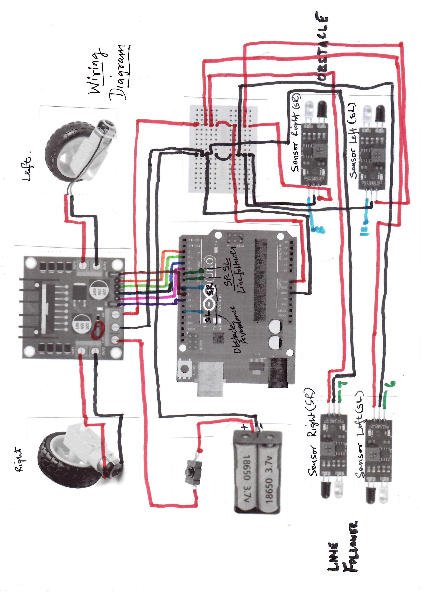

# 🤖 Build Your First Robot — Line Follower AND Obstacle Avoider

This is **A beginner-friendly, four-part robotics tutorial series** covering components, electronics testing, mechanical design, wiring, assembly, programming, and debugging.

This project builds a two-wheel-drive robot around an **Arduino Uno** and **L298N motor driver**. Two downward-facing IR sensors are intended for **line detection**, while two forward-facing IR proximity sensors are intended for **obstacle detection**. A castor wheel supports the chassis.

The aim is not just to copy a circuit: it is to understand how a robot **senses → decides → acts**.

> **Project status:** All four tutorial videos are now published! Part 4 demonstrates final assembly, wiring, programming, debugging, and two independent operating modes: obstacle avoidance followed by line following. The Arduino must be reprogrammed to switch modes; simultaneous operation is not implemented.

## 📺 Video series

| Part | Topic | What you'll learn | Video |
| --- | --- | --- | --- |
| 1 | Meet the Components | Arduino Uno, IR sensors, DC geared motors, L298N, breadboard, batteries, and chassis | [Watch Part 1](https://youtu.be/XjlF20aM-ws) |
| 2 | Test the Components | Blink the Arduino's built-in LED; read an IR sensor; control a DC motor with L298N and PWM | [Watch Part 2](https://youtu.be/_JVOipfSpaY) |
| 3 | Design Before Building | Structural layout, wiring diagram, and measuring/marking the MDF board | [Watch Part 3](https://youtu.be/1v-kZ-qdY1c) |
| 4 | Final Assembly, Code & Live Demo | Drill and mount components, complete wiring, upload and debug the two sketches, and demonstrate obstacle avoidance followed by line following | [Watch Part 4](https://youtu.be/mQKTWAQDVwA) |

The videos use **Hindi with English technical terms** and are intended for students, hobbyists, and first-time makers.

## 🧰 Hardware and materials

| Quantity | Component | Purpose |
| ---: | --- | --- |
| 1 | Arduino Uno | Reads sensors and controls motor driver |
| 1 | L298N dual H-bridge motor driver module | Controls two DC motors |
| 2 | DC geared motors | Left and right drive |
| 2 | Compatible wheels | Attach to motor shafts |
| 1 | Castor wheel | Third point of support |
| 2 | Downward-facing IR reflectance/proximity modules | Detect the line against the floor |
| 2 | Forward-facing IR proximity modules | Detect nearby obstacles |
| 2 | 3.7 V rechargeable cells | Power source, subject to safe wiring and voltage checks |
| 1 | Appropriate two-cell holder / protected battery arrangement | Secures and connects cells safely |
| 1 | Small breadboard | Helps distribute and organize low-current connections |
| As needed | Jumper wires | Signal and power interconnections |
| 1 | MDF board | Chassis/base plate |
| As needed | M2/M3 screws, nuts, spacers, motor mounts | Mounting hardware |

**Also useful:** ruler, marker, drill and appropriate bits, screwdriver, multimeter, USB cable, and a computer with the Arduino IDE.

> **Sensor note:** IR obstacle modules and line-tracking modules may look similar, but their suitability, output polarity, detection range, and calibration differ. Test each actual module before using it in the final robot.

## 🧠 How the robot works

```text
  Left + right line sensors ─┐
                             ├──> Arduino Uno ──> L298N ──> Left motor
  Left + right obstacle ─-───┘                        └-──> Right motor
  sensors

  Battery / power system ──> suitable power inputs
  All signal/control circuits share a common GND
```

1. **Sense:** IR modules report reflected light or nearby objects.
2. **Decide:** The Arduino interprets sensor readings according to the program.
3. **Act:** The L298N drives the left and right motors to move, steer, or stop.

**Current software:** Two independent sketches are provided: `Linefollower.ino` and `ObjAvoidance.ino`. Upload one sketch at a time. The supplied code does **not** yet combine line following and obstacle avoidance into a single running program.

## 🔌 Confirmed Arduino pin configuration

The pin assignments below come directly from the two supplied Arduino sketches (not from an assumed wiring diagram).

| Function | Arduino Uno pin | L298N / sensor connection |
| --- | --- | --- |
| Right motor direction 1 | D2 | Right motor channel IN1 (verify physical channel labels) |
| Right motor direction 2 | D3 | Right motor channel IN2 |
| Left motor direction 1 | D4 | Left motor channel IN1 (verify physical channel labels) |
| Left motor direction 2 | D5 | Left motor channel IN2 |
| Left line sensor | D6 | Digital OUT of left downward-facing sensor |
| Right line sensor | D7 | Digital OUT of right downward-facing sensor |
| Right obstacle sensor | D8 | Digital OUT of right forward-facing sensor |
| Right motor speed / enable | D9 (PWM) | L298N enable for right motor channel |
| Left motor speed / enable | D10 (PWM) | L298N enable for left motor channel |
| Left obstacle sensor | D12 | Digital OUT of left forward-facing sensor |
| LED output (declared) | D13 | Onboard LED / optional indicator; no LED writes in current sketches |

**Important:** IN1/IN2 naming in the table is descriptive, not a verified mapping to the board's printed IN1–IN4 labels. Confirm which L298N output channel is connected to each motor before wiring. D9 and D10 require appropriate ENA/ENB jumper configuration for PWM control. Sensor power and motor power connections are not specified by the code.

## 🗺️ Wiring diagram and confirmed build details

The original wiring diagram is a hand-drawn reference supplied by the builder. It shows:

- Two **3.7 V 18650 cells connected in series** (7.4 V nominal) and a power switch feeding the L298N module.
- The L298N driving **two independently controlled DC geared motors** (left and right wheels).
- A small breadboard distributing power and ground to the **four IR sensor modules**.
- Two **downward-facing** sensors for line following and two **forward-facing** sensors for obstacle detection.
- Arduino Uno digital signals connected to the sensors and L298N; the pin table above is based on the actual sketches.



> **Diagram availability:** Save the supplied image as `Wiring_Diagram.jpeg` at the repository root for the image above to display on GitHub. This is a project illustration, not a certified electrical schematic. Check every physical terminal against the actual module markings, especially motor enable jumpers, the L298N 5 V regulator configuration, and the Arduino 5 V/GND supply wiring.

### Two separate robot modes

The robot does **not** run line following and obstacle avoidance simultaneously. The user uploads **one Arduino sketch at a time** and must reflash the Arduino to switch behaviors. Part 4 demonstrates **obstacle avoidance first**, followed by **line following**.

## 💻 Arduino programs and behavior

The two original sketches have been formatted and commented without changing their executable logic:

- [`Linefollower.ino`](Linefollower.ino) — reads the two downward-facing line sensors.
- [`ObjAvoidance.ino`](ObjAvoidance.ino) — reads the two forward-facing obstacle sensors.

### Line-following mode

| Left sensor (D6) | Right sensor (D7) | Action |
| --- | --- | --- |
| LOW | LOW | `forward()` |
| HIGH | LOW | `left()` |
| LOW | HIGH | `right()` |
| HIGH | HIGH | `stop()` |

`vspeed = 50`, `tspeed = 50`, `tdelay = 0` (PWM values on a 0–255 scale; delay in milliseconds). The sketch waits 5 seconds during `setup()` before entering its loop. The `backward()` function is defined but not called.

### Obstacle-avoidance mode

| Left sensor (D12) | Right sensor (D8) | Action |
| --- | --- | --- |
| LOW | LOW | `stop()` |
| HIGH | LOW | `right()` |
| LOW | HIGH | `left()` |
| HIGH | HIGH | `forward()` |

`vspeed = 100`, `tspeed = 100`, `tdelay = 2000 ms`, `rdelay = 700 ms`. Both turning routines call `stop()`, reverse for 700 ms, then turn for 2000 ms. The sketch waits 5 seconds during `setup()`. **The obstacle sensor truth table above reflects the code, not a guarantee of sensor active-high polarity.** Verify the actual module outputs experimentally.

### Running the sketches

1. Connect the hardware according to the pin table and a verified power wiring diagram.
2. Open the desired `.ino` file in Arduino IDE (keep it in a same-named sketch folder if the IDE requests it).
3. Select **Arduino Uno** and the correct serial port.
4. Upload **one** sketch and test the robot safely with the drive wheels initially raised.
5. Re-upload the other sketch when switching modes.

**Not implemented in these files:** a combined program that prioritizes obstacle detection while following a line. That would require a new sketch and additional testing.

## 🗂️ Suggested repository structure

The repository can grow with the series. Most files below are **suggested names**; the two Arduino sketches are supplied files. The links above assume the `.ino` files are placed in the repository root. Update those links if you place them elsewhere.

```text
build-your-first-robot/
├── README.md
├── Wiring_Diagram.jpeg
├── Part1-Components/
│   └── Components_List.docx
├── Part2-Testing/
│   ├── LED_Blink/
│   │   └── LED_Blink.ino
│   ├── IR_Sensor_Test/
│   │   └── IR_Sensor_Test.ino
│   └── Motor_Test/
│       └── Motor_Test.ino
├── Part3-Design/
│   ├── chassis-layout.jpg
│   ├── wiring-diagram.jpg
│   └── measurements.pdf
└── Part4-Final-Robot/
    ├── Linefollower.ino
    └── ObjAvoidance.ino
```

Arduino sketches (`.ino`) are kept inside folders with matching names for convenient opening in the Arduino IDE.

## 🚀 Getting started

### 1. Get the project files

Clone the repository using its actual GitHub URL:

```bash
git clone https://github.com/vishalckgupta/build-your-first-robot.git
```

Or use **Code → Download ZIP** on the repository page.

### 2. Test the components individually

Follow **Part 2** before assembling the complete robot:

- Upload a built-in LED blink sketch to verify the Arduino and USB upload path.
- Connect one IR module and inspect its output using the Serial Monitor.
- Connect one DC motor through the L298N and verify forward, reverse, and PWM speed control.
- Repeat relevant tests for the second motor and remaining sensors.

### 3. Plan and mark the chassis

Follow **Part 3**:

- Arrange motors, castor, battery, Arduino, driver, breadboard, and sensors on the MDF board.
- Check wheel clearance, balance, accessibility, sensor height/orientation, and wire routing.
- Measure twice and mark mounting holes before drilling.
- Compare every intended connection with the wiring diagram and your actual module labels.

### 4. Assemble and program

Follow **[Part 4](https://youtu.be/mQKTWAQDVwA)** for the final assembly, programming, debugging, and live demonstrations. The two Arduino sketches and their pin assignments are documented above. Confirm the physical wiring and upload one sketch at a time; the combined mode is not yet implemented.

## ⚡ Power and wiring safety

- **The actual build uses two 3.7 V 18650 cells in series:** approximately **7.4 V nominal** and **8.4 V fully charged**. The battery pack is switched and feeds the L298N motor-supply input. Confirm cell matching, protection, charging method, polarity, and component ratings before connecting it.
- The **L298N has a significant voltage drop**, so the motors receive less than the battery voltage under load. Check the motors' rated voltage and current and verify that the chosen supply can start them reliably.
- **Do not power motors directly from Arduino GPIO pins or the Uno's 5 V pin.**
- **Connect Arduino GND and L298N GND together** when using Arduino control signals.
- **Actual build power arrangement:** the L298N module’s onboard regulated **5 V output** is used to supply the Arduino Uno and four IR sensors, as reported by the builder. This is **not a universal recommendation**: regulator operation depends on module design, jumper settings, battery voltage under load, and total current draw. With a 2-cell battery pack, regulator dropout or motor-induced voltage sag may cause Arduino resets. Verify the 5 V rail with a multimeter while motors run; a suitably rated independent 5 V buck regulator is a more robust option.
- **Arduino 5 V pin caution:** feeding a regulated 5 V rail into the Uno’s 5V pin bypasses the onboard regulator and requires a verified, stable supply. Avoid connecting USB and an external 5 V supply simultaneously unless the board’s power-path arrangement is understood. Do **not** connect the L298N’s 5 V output to the Uno VIN pin.
- L298N modules differ: inspect the **ENA/ENB jumpers** and **5V regulator-enable jumper**. Never assume the module’s 5V terminal is safe to connect as an output or input without checking its configuration.
- Avoid short circuits on the breadboard, keep exposed battery terminals insulated, and disconnect power before rewiring.
- Use suitable charging/protection equipment for lithium-ion cells; do not charge loose cells through the Arduino or L298N.
- Keep fingers, wires, and tools clear of spinning wheels during tests.

## 🔍 Troubleshooting checklist

| Problem | Things to check |
| --- | --- |
| Arduino sketch won't upload | Correct board and COM port; data-capable USB cable; Arduino IDE messages |
| IR sensor readings don't change | VCC/GND/OUT wiring; surface or target distance; sensitivity potentiometer; module output polarity |
| Motor does not run | External motor supply; common GND; motor on correct OUT terminals; IN pins; ENA/ENB jumper or PWM signal; motor tested separately |
| Motor turns the wrong way | Swap motor leads or invert direction logic in code |
| Motor doesn't visibly accelerate | Add a short delay between PWM changes; check minimum starting duty cycle and battery voltage |
| Robot loses the line | Sensor placement/height; track contrast; threshold calibration; speed; steering logic |
| Robot resets when motors start | Battery voltage sag, inadequate supply/current capacity, poor wiring, electrical noise |

**Debugging tip:** Change one thing at a time, observe the result, and retest. A robot that misbehaves is a great teacher. 😄

## 📚 Project goals

By the end of the series, you should understand:

- Digital inputs and outputs on Arduino Uno
- IR sensing for line and obstacle detection
- DC motor direction control using an H-bridge
- PWM-based speed control
- Mechanical layout and basic chassis fabrication
- Wiring, power distribution, and common-ground principles
- Incremental testing and debugging

## 🤝 Questions and improvements

If you build your own version, share what worked and what you changed in the YouTube comments or open a GitHub Issue (if enabled). Useful details include the exact sensor model, motor rating, power supply, wiring diagram, code, and observed behavior.

## 👨‍🏫 About the creator

Created by **Vishal CK Gupta**, a software/embedded systems engineer and robotics educator, as a practical introduction to robotics.

**Keep Learning. Keep Experimenting. Keep Building! 🤖**

---

*This is an educational hobby project. Verify all electrical and mechanical connections against the specific components you own before applying power.*
